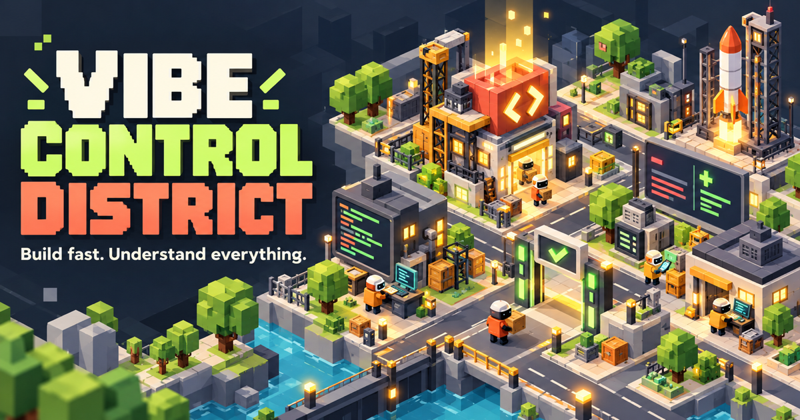

# Vibe Control District



Vibe Control District turns “the agent changed some files” into something you can actually explain.

Every stable code change becomes a work order. You choose one of five district agents—James, Ben, Ollie, Luc, or Miguel—and send that person to any available village project. When the work stops, a three-choice checkpoint appears. Answer correctly and the building improves.

The point is not to test syntax trivia. It is to make sure you still understand the product you are shipping while Codex, Claude, or a terminal-based agent is moving quickly.

## What is playable today

The current build is a complete interactive demo of the expanded game loop:

- a large map that can be panned and zoomed
- a connected road grid with reserved plots for future buildings
- movable completed buildings, decorations, and road segments
- a shop, blueprint inventory, and placement mode
- a five-person agent roster that can take work from Codex, Claude Code, or a terminal
- workers that follow the connected road network from the Guild to the chosen project
- work orders that can be assigned to any free building or construction site
- Beginner, Builder, and Expert question levels
- multi-stage checkpoints for large changes and three choices per question
- question-specific file snippets with highlighted additions and removals
- explanations after correct and incorrect answers
- building upgrades, XP, coins, and streaks
- a final deployment checkpoint after all worksites are cleared
- village layout, inventory, progress, and work orders saved in the hosted database
- controls for removing one finished/unassigned task, clearing finished history, or clearing the built-in demo tasks
- responsive layouts for desktop and mobile

The built-in tasks demonstrate the loop immediately. For real work, the included local watcher turns stable Git changes from another repository into new work orders on localhost.

## How to play

1. Choose your coding knowledge level from the top-right menu.
2. Open a work order to see its source tool, affected files, and size.
3. With Claude Code hooks installed, the moment you submit a prompt, choose an available agent: James, Ben, Ollie, Luc, or Miguel.
4. Choose a free building or unfinished blueprint. The selected agent leaves the Builders’ Guild and follows the roads while the real coding session continues.
5. When Claude finishes the turn, questions are generated from that turn's diff. The worker returns to the Guild along the roads and the review opens on arrival.
6. Use those highlighted changes to answer the three-choice understanding check.
7. Small changes complete quickly; large changes move through several logical stages.
8. Correct answers upgrade the target and award XP and coins. Wrong answers pause progress and provide a hint.
9. Use **Clear finished** to remove completed task history, **Clear demo** to remove the three simulator tasks, or **Remove task** inside a completed/unassigned task.

Use the **Shop** to buy blueprints, **Inventory** to place them, and **Arrange** to move completed village items or roads. Drag a road to reposition it; double-click it to rotate it. A placed blueprint remains unfinished until an agent work order is assigned to it.

You can change the knowledge level at any time:

- **Beginner** focuses on what a change lets the user do.
- **Builder** asks why an implementation choice was made.
- **Expert** asks about security, data integrity, race conditions, and trade-offs.

Progress is stored in Cloudflare D1, so refreshing the page does not reset the village. Local development uses a local D1 database. **Reset demo** restores the full starter village; the Clear controls remove task cards without undoing earned village upgrades.

## How questions are created

In this first version, the sample questions are defined in [`app/game-data.ts`](app/game-data.ts). Each construction stage has three versions of the same idea—Beginner, Builder, and Expert—plus:

- a short, plain-language description of the code change
- the relevant file path and only the changed lines needed to investigate the question
- exactly three possible answers
- one unambiguous correct answer
- an explanation of why that answer is correct

The live question pipeline is:

1. A lifecycle adapter records that the coding turn started; the generic watcher falls back to detecting the first Git change.
2. It reads the relevant `git diff`, file path, and a small amount of surrounding code.
3. A model summarizes the user-visible effect and selects a question depth based on the player’s knowledge level and answer history.
4. It returns structured data containing one question, three choices, one correct answer, and one explanation.
5. The game validates that structure before displaying the checkpoint.
6. Only the developer’s answer changes game progress; the agent does not decide that the developer understood the code.

A useful rule for generated questions is: ask about **behavior and consequences before implementation vocabulary**. “What changes for the user?” is usually more valuable than “Which hook appears in this file?”

## Local Claude Code and terminal integration

The local companion is included. For Claude Code, lifecycle hooks open the work order before Claude starts processing the prompt and finish it when Claude stops responding. The `git diff` is used for question evidence, not as the clock that decides whether the agent is working. A polling watcher remains available for Codex and ordinary terminal tools that do not expose start/stop hooks.

The active setup looks like this:

```text
Claude prompt submitted → work order opens immediately
              ↓
worker is selected and walks to the chosen building
              ↓
Claude finishes the turn → that turn's diff is collected
              ↓
Claude Code (or the local fallback) creates a checkpoint
              ↓
worker carries the questions back to the Guild
```

### Try it with a Claude Code project

Start the game in one terminal:

```bash
cd /Users/kuzeyerturk/Desktop/gamegenticAI
npm run dev
```

Open `http://localhost:3000`, then install the local lifecycle hooks into the Git repository you use with Claude Code. This writes only `.claude/settings.local.json` in that target project:

```bash
cd /Users/kuzeyerturk/Desktop/gamegenticAI
npm run install:claude-hooks -- --project /absolute/path/to/your-project --claude-questions
```

Restart Claude Code in the target project after installation. You can type `/hooks` inside Claude Code to verify the `UserPromptSubmit` and `Stop` hooks. Continue working normally: submitting a prompt immediately creates an unassigned work order, and Claude's real `Stop` event finishes it. If a prompt makes no code change, its temporary work order is removed automatically. The worker always spends a short minimum time at the worksite, so tiny changes do not produce an instant turn-around animation.

The Claude adapter:

1. runs on your Mac and watches the repository path you provide
2. creates a pending work order from Claude Code's `UserPromptSubmit` event, before Claude processes the prompt
3. snapshots the pre-task diff so unrelated existing changes are not treated as new work
4. uses Claude Code's `Stop` event as the completion signal
5. ignores `.git`, `node_modules`, build output, secrets, and environment files
6. uses `git diff` only to build the review evidence and questions
7. ignores common secret files such as `.env`, credentials, and private keys

The `--claude-questions` option uses your installed and authenticated Claude Code CLI in non-interactive print mode to turn the selected diff into 1–4 knowledge stages. This sends the selected diff through Claude Code. The question-generation subprocess disables hooks so it cannot create a recursive game task. Without that option, the diff stays entirely on your Mac and deterministic fallback questions are used:

```bash
npm run install:claude-hooks -- --project /absolute/path/to/your-project --no-ai
```

For Codex, shell scripts, or any tool without a lifecycle hook, use the generic watcher instead:

```bash
npm run watch:agents -- --project /absolute/path/to/your-project --source Codex --claude-questions
```

Useful options:

- `--claude-questions` explicitly enables semantic question generation through Claude Code.
- `npm run install:claude-hooks -- --project ...` installs exact per-prompt Claude start/stop tracking.
- `--once` sends one stable change and exits.
- `--settle 8000` waits eight seconds after the last edit before creating a task.
- `--source Codex` or `--source Terminal` changes the worker label.
- `npm run watch:agents -- --help` prints the full command reference.

The local connector rejects requests on hosted deployments; real repository events are accepted only by the localhost app.

## Run it locally

Requirements:

- Node.js 22.13 or newer
- npm

```bash
git clone https://github.com/KuzeyErturk/gamegenticopia.git
cd gamegenticopia
npm install
npm run dev
```

Open the local address printed in the terminal, normally `http://localhost:3000`.

Create a production build with:

```bash
npm run build
```

## Project map

```text
app/page.tsx       game state, map tools, rewards, and interactions
app/game-data.ts   work orders, staged questions, shop items, and starter village
app/api/village/   database load and save endpoint
app/globals.css    village map, buildings, panels, and responsive layout
app/layout.tsx     page metadata and social sharing settings
db/                D1 schema and village state storage
public/og.png      Vibe Control District share image
worker/            Cloudflare-compatible server entry
```

## What comes next

The accepted architecture for the real product is documented in [`docs/LOCAL_FIRST_DIRECTION.md`](docs/LOCAL_FIRST_DIRECTION.md).

- a native Codex lifecycle adapter matching the Claude hook integration
- richer session boundaries for separating several edits made to the same uncommitted diff
- per-project villages and longer upgrade paths
- a review screen showing what the player understood before deployment
- optional team mode, where different developers clear different worksites

Vibe Control District should slow an agent down only when understanding is missing—not when the developer already knows exactly what changed.
